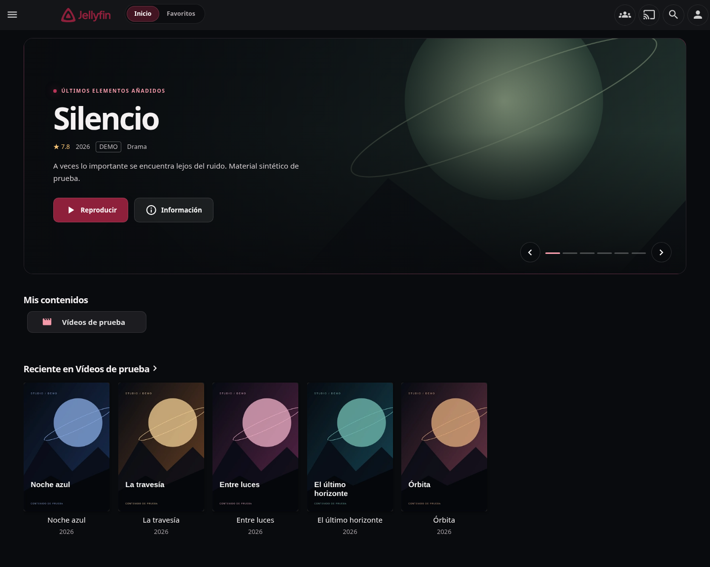

# Jellyfin Studio

Servidor multimedia basado en Jellyfin con una interfaz moderna. Incluye el
código fuente del servidor en `server/` y del cliente oficial en `web/`, ambos
basados en **Jellyfin v10.11.11**. El tema **Studio** es la primera capa visual:
superficies oscuras, acento rojo granate, navegación en cápsulas y carátulas
con bordes suaves, tomando las capturas de tofa.tv como referencia visual.
El resto de los temas oficiales sigue disponible en los ajustes de pantalla.

El inicio Studio incluye una portada de películas recientes con fondo, sinopsis,
metadatos y acciones de reproducción/reanudación y detalle. El carrusel cambia
manualmente, las bibliotecas usan accesos compactos y los carriles originales
de continuar viendo y novedades conservan su configuración. El contenido se
consulta con los permisos del usuario conectado: no se inventan recomendaciones
ni carátulas. Una biblioteca sin películas mantiene el estado original de Jellyfin.

Captura real del contenedor con una biblioteca sintética de demostración:



[Versión móvil](docs/screenshots/movil.png) · [Reproductor](docs/screenshots/reproductor.png)

Los vídeos y carátulas de prueba de las capturas no están incluidos en la imagen.

## Docker y Unraid

```bash
docker build -t jellyfin-studio:local .
```

La plantilla importable está en [unraid/jellyfin-studio.xml](unraid/jellyfin-studio.xml)
y las instrucciones en [unraid/README.md](unraid/README.md). Usa un puerto y
carpetas de datos independientes de tu Jellyfin actual. El workflow de GitHub
construye y publica la imagen en GHCR al actualizar `main`; su disponibilidad
debe comprobarse después de que termine. Para probar sin registro, construye la
imagen local y cambia `Repository` en la plantilla a `jellyfin-studio:local`.

## Desarrollo

Requisitos: Node.js >=20 (upstream recomienda Node 20), npm 10, SDK .NET 9,
FFmpeg y FFprobe. En Linux también se necesitan las bibliotecas nativas de
Jellyfin, incluidas fontconfig y FreeType. Para transcodificación completa usa
la distribución oficial `jellyfin-ffmpeg`; el FFmpeg del sistema sirve para
desarrollo básico, pero no garantiza todas las funciones de Jellyfin.

Desde la raíz del repositorio:

```bash
bash scripts/setup.sh
bash scripts/build.sh
bash scripts/start.sh
```

La instalación conserva los lockfiles y coloca npm 10 y el SDK, cuando hace
falta, en `../.tools/` (se puede elegir otra ruta con `JELLYFIN_STUDIO_TOOLS`).
Los datos locales, configuración, caché y logs se guardan en `.local/`, ignorado
por Git. El servidor utiliza el puerto 8096 por defecto y sirve el cliente
compilado desde `web/dist/`. La primera ejecución muestra el asistente oficial;
no se crean cuentas, contraseñas ni bibliotecas de ejemplo automáticamente.

Para recarga automática del cliente, con el servidor iniciado:

```bash
source scripts/env.sh
cd web
npm start -- --host 127.0.0.1
```

Selecciona el servidor local en el cliente de desarrollo. No expongas una
instancia sin configurar fuera de tu entorno de desarrollo.

## Validación

```bash
source scripts/env.sh
(cd web && npm run build:check && npm test)
(cd server && dotnet test tests/Jellyfin.Common.Tests -m:2)
curl --fail http://127.0.0.1:8096/System/Info/Public
curl --fail http://127.0.0.1:8096/health
```

El tema está en `web/src/themes/studio/theme.scss`; las vistas React usan la
paleta `studio` de `web/src/themes/themes.ts`. La selección inicial está en
`web/src/config.json`. La autenticación, reproducción y gestión multimedia
siguen usando el código oficial de Jellyfin.

La portada moderna está en `web/src/components/studio/StudioHome.tsx` y sus estilos
en `studioHome.scss`. Se monta desde `web/src/controllers/hometab.js` únicamente
al usar Studio y se desmonta con el ciclo de vida de la página.

Consulta [UPSTREAM.md](UPSTREAM.md) para los commits originales y el proceso de
actualización. Se conservan las licencias originales en
[server/LICENSE](server/LICENSE) y [web/LICENSE](web/LICENSE).
Este proyecto es un derivado independiente de Jellyfin.
Jellyfin Studio se distribuye bajo GPL-2.0-or-later; consulta [LICENSE](LICENSE).
